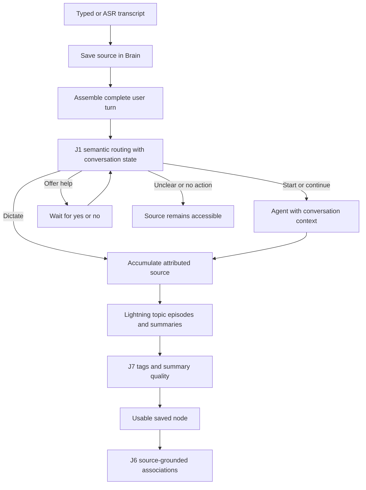

# Agent phase architecture

The Agent saves source text before deciding what to do with it. A Brain implementation provides storage and retrieval through `BrainPort`; it does not own conversation policy, speech, or model calls. Speech uses local **Whisper large-v3-turbo + Silero speech detection + the `Moo.` hint**, with full large-v3 as an explicit configuration option. [Speech implementation and configuration](whisper-integration.md).

## Modules and ownership

| Module | Responsibility |
| --- | --- |
| `packages/contracts` | Host-neutral records, revisions, provider/Brain interfaces and portable Markdown codec. |
| `packages/agent` | Conversation state, routing, tool execution, help offers, enrichment, retries and local-versus-accepted status. It imports no Electron, database, Obsidian or provider SDK. |
| `packages/brain` | SQLite/file persistence and a separate in-memory adapter. Neither is required by the Agent class; the host injects a `BrainPort`. |
| `apps/runtime` | Independently runnable Node host, authenticated loopback HTTP/SSE API, backend transport and native process bridge. It wires implementations together. |
| `apps/desktop` | Electron/React chat, persistent graph and a three-tab note reader. It communicates with the runtime rather than owning the Agent. |
| `native` | Swift microphone capture, the local ASR protocol, PCM playback, explicit Apple speech fallback and requested screen capture. A host-owned pinned Kokoro worker supplies default speech. |
| `scripts` speech adapter | Pinned resident whisper.cpp runtime and a bounded local PCM/utterance bridge; model choice comes from `asr-config.json`. |
| `backend` | One FastAPI service for Jev, Nebius and Tavily calls plus accepted Postgres snapshots. Provider credentials stay in this process. |

There is no plugin registry or service per Jev gate. Replacing the Brain means supplying another `BrainPort` and changing host wiring. The standalone runtime and native companion remain usable without the custom desktop UI.

Closing the desktop window or quitting stops microphone capture and speech through the existing runtime controls; it retains saved conversation state and does not terminate the reusable runtime. Renderer failure also requests audio shutdown. Reopening does not enable the microphone automatically. Minimize/focus changes leave capture unchanged. These graceful handlers cannot run after a forced termination of Electron's main process; that case still needs runtime-side disconnect supervision.

## One retained source, three Jev jobs

**J1** chooses among state-appropriate `start_agent`, `continue_agent`, `check_status`, `offer_help`, `end_agent`, `suppress_note`, `dictate`, `no_action` and `unclear`. Pending help, clarification and work are context for this same gate. General help waits for acceptance without screen capture; the screen-assisted saved-doubt offer remains distinct. Clarification links the original request and intermediate constraints.

An active exchange receives every speech block continuously. J1 runs after a complete turn is assembled, not on every chunk; `continue_agent` preserves the exchange. Stable segment IDs and revisions protect corrections. Durable turn ownership sends late corrections back to their original note or conversation. Queued turns retain all their blocks before response generation. J1 receives the assembled turn, recent session context and linked clarification/help request. A speech block does not close a conversation.

Natural endings, **“Moo, finish conversation”** and the End control initiate closing. A provisional 0.8 threshold guards start, stop and help acceptance. Selected dictation while idle and continuation while active preserve that flow without clarification solely because confidence is low; explicit unclear still asks for clarification. Pending work requires finish, cancel or continue. A finish choice can be retracted while work remains. New speech invalidates delayed closure. Controls remain in the source transcript without requiring individual knowledge nodes.

The main agent can return a separate `controlProposal`, never an executable task tool. J1 verifies it against the actual latest user turn and revision; the assistant’s proposed reason is excluded from evidence. A durable operation permits at most one fallback verification per revision. Task completion alone cannot close. The controller applies verified closure after its response scope ends, avoiding a false pending-work offer caused by its own busy flag. These hybrid races are covered by fixture regression tests; the live model did not exercise every fallback case.

An opt-in comparison policy can record a pending closing question with its conversation, source turn and revision. A reply then uses closing-specific criteria within the same J1 call. Stale questions and decisions cannot close; a subsequent clarification replaces the pending question. This policy has no desktop setting and is not enabled by production hosts. Conversation closure remains separate from stopping microphone capture.

**J7** assesses the generated node together with its source. Its purpose vocabulary is Question, Reference, Idea and Action. Lightning proposes up to three editable topic suggestions; J7 independently detects unresolved doubt, and can add Off-topic relative to the subject recorded for that note. A subject change during a provider request cannot change the meaning of the assessment halfway through.

Summary quality is Pending, Ready or Needs review. Fidelity and understandable context determine quality; a thought's relevance or value does not. Off-topic and Ready can coexist. The default decision threshold is a configurable, provisional `0.8`, not an evaluated accuracy guarantee. Missing/nonfinite quality assessments cannot produce Ready.

**J6** scores at most five candidates retrieved using retained source text. It automatically accepts scores at least 0.8 with generated provenance, confidence and assessed revisions; dismissed links remain dismissed. Summary readiness is independent from association assessment. Stale endpoints cannot receive generated links. Failed linking is visible and retryable; it does not erase the note.

## Persistence and failure handling

- Each input first updates the durable session transcript; active conversations are also updated continuously. SQLite uses transactions and full synchronization. Returned records are detached from adapter state.
- Source revisions change only when a newer segment revision arrives. Record revisions support compare-and-set enrichment and manual edits. Stale provider results are superseded, and protected manual fields survive later generated patches.
- Server acceptance is separate from local saving. Acknowledgments update synchronization metadata without creating another content revision. Each acceptance operation retains its original serialized payload; retry never reuses an operation ID with newer content.
- Operations and dialogue state survive SQLite restart. The desktop’s note-scoped summary retry dispatches only that note’s enrichment; it cannot replay J1 transitions, conversations or tools. Other failed/interrupted work remains explicitly retained. A superseded source schedules current enrichment. Per-record enrichment is serialized rather than allowing competing background writes.
- Attachments have immutable, path-safe IDs and local files. Accepted backend records currently contain attachment references; media upload and two-way synchronization are later work.
- The neutral Markdown codec retains authored content, readable source/summary and namespaced record metadata, preserving unfamiliar frontmatter and prose outside its generated section. The desktop exposes no export/import routes or filesystem permissions for note transfer. Transfer is not part of the public runtime surface.

The agent tools are note search/read/create, selected-folder search/read, requested screen capture and web search/extraction. “Use only my notes” both removes web tools from the offered list and blocks their execution. Extraction accepts only URLs returned by search in the current response task. Tasks are bounded to six model/tool rounds. Sources beyond the initial enrichment size limit remain intact with a visible processing error rather than being silently truncated.

An optional injected `previewTool` supports validation. Argument and permission checks run first; allowed and blocked proposals are recorded. Results are labelled fixtures with `executed:false`; note creation never returns a saved ID. This also covers accepted saved-doubt capture. Ordinary operation does not install the hook. Source saving, enrichment and isolated backend acceptance still execute in the harness.

## Retrieval and finalization

`BrainPort.search(query, limit, {excludeIds?, kinds?})` applies scope before ranking and limiting. The shared lexical rank uses meaningful whole words, title/topic weights and inverse document frequency. It is intentionally a small local implementation, replaceable in the Brain phase.

`LocalFilesPort` is injected separately from BrainPort. Its ripgrep/filesystem adapter lives in `packages/local-files`; no OS/process imports enter the Agent. Trusted Electron folder selection persists explicit grants through the authenticated loopback runtime; arbitrary renderer paths cannot grant access. Local evidence is refreshed and fingerprint/grant checked before answer publication.

The native response loop retains up to five current Brain excerpts and five local file references plus recent typed tool outcomes. Retrieval errors are distinct from no matches; note revisions, complete user transcript revisions and linked requests are checked before publishing. Current Brain passages appear directly in the latest relevant tool response, with complete/partial source coverage, rather than IDs alone. Each retained passage appears once; evidence without a tool result in the current request stays in the authoritative index. Messages are rebuilt from current revisions before every generation, while historical tool outcomes remain durable. Rejected retrieval stays rejected even when independently retained evidence can answer the question. The sixth call is answer-only, and there is one grounded invalid-query repair.

Search results and query-based `read_note` requests select exact section-aware passages, with omitted ranges and source dates kept separate from import/update timestamps. Explicit offsets take precedence. Additional passages remain distinct source windows; refreshed evidence reruns the original selection against the current revision. Versioned retrieval and final-answer instructions are loaded into actual requests. The backend checks the complete encoded request before dispatch. Structural final-answer admission retains empty, promise-only or protocol-only drafts as failures without another paid request; it does not certify factual accuracy.

The unanswered request and its derived notes cannot serve as independent answer evidence. Search excludes these projections before its five-result limit; direct reads, retained evidence and graph traversal apply the same policy. Earlier settled episodes from the same conversation remain available. This also prevents publishing an answer from updating its own growing evidence and invalidating narration. The original request remains in conversation context and its source is retained.

Finalization uses existing pending operations and a SHA-256 identity of complete summary context, with source/manual edit checks and explicit retry of failed/interrupted provider work. Close, cancel, capture/session stop and restart checkpoint the same conversation. Lightning sees linked original requests and observed tool outcomes, including unresolved/cancelled work. J7 assesses fixed purposes and fidelity/context; Lightning supplies editable topics; J6 assesses source-grounded connections independently of summary readiness. No extra gate or service was introduced.

The desktop reader and neutral record contracts are public. A richer editor/search index and two-way synchronization remain future work. Selected-folder Markdown reads are read-only evidence tools, not a vault integration.

## Contextual image help

J1 can propose a screen-help offer while retaining the original question and source revision. Acceptance resumes that request with any added constraints; decline, unrelated replies and stale/corrected offers do not authorize capture. The controller takes one fresh screenshot for an accepted request and sends the image and question to MiniCPM. Ultra receives structured vision evidence rather than image bytes.

OCR fields distinguish readable, unreadable and absent values with source excerpts and visible labels. Visual mode provides located features and tentative hypotheses referencing those features. Contradictory or unsupported evidence is withheld while raw output remains retained. These checks cannot independently establish pixel truth; an uncertain model result remains unresolved. The focused Brain reader keeps original image evidence accessible without exposing raw provider output as note prose.

The OCR adapter explicitly requests copied table-header and selected-row cells before their column indices. Its versioned instruction is paired with an actual strict JSON-schema response format, including nullable support for unreadable headers. It validates cell widths, units, qualifiers and requested-field scope before converting them to the existing public evidence format. It does not reconstruct headers from the question. Contradictory excerpts and unrelated absence claims remain in raw diagnostics and cannot support an answer. Older stored table evidence remains readable. Schema conformance is not proof of image accuracy; unsupported schema requests fail visibly without a second request or model substitution.

Tests exercise the same controller against MemoryBrain and SQLiteBrain and separately verify restart durability. This establishes replaceable storage boundaries; it does not by itself validate every host adapter. Automated fixtures do not prove provider accuracy or microphone performance.

## Voice review flow

J1 clarification asks “Would you like Moo to answer that?” and retains the original request through the reply. Closure emits one “Conversation closed. Your transcript is saved.” acknowledgement; summary processing remains a separate record state, and an enabled session returns to dictation.

Production responses use the backend-reserved `deliver_answer` presentation function to return full `text` and a concise `spokenText` paragraph in the same model call. It never executes a task or closes the conversation; final answer-only mode instead requests the same JSON schema with no tools. The paragraph is spoken by default. Optional section-linked `spokenOutline` metadata serves requested walkthroughs and cannot invalidate a useful paragraph or written answer. Missing narration has a specific presentation failure without another paid call. Speech onset invalidates pending routing and generation, stops playback and leaves the conversation/source intact. Native status events update the desktop immediately.

Recent same-session dictation is supplied as attributed context with current revisions, bounded passages and truncation flags. Backward references link captures without merging them. Brain retrieval is preferred for saved notes; local-file tools are omitted when no roots are granted. Search scope is query-specific, not an inventory count.

Consolidation packs typed tool outcomes and evidence references alongside source conversation/linked requests. Complete raw outcomes remain separate and included in revision checks. Oversized source conversation text and incomplete provider output remain explicitly failed/pending with manual retry; this does not trigger automatic paid calls.

## Semantic note organization

Production generation providers expose a narrow `consolidate` operation beneath the existing Agent. Eligible speech first creates an inspectable draft, backed by the durable session transcript. The first background pass is scheduled after about six seconds, then new content is coalesced at roughly one-minute intervals, including during active Agent work. At most one organization call processes new source (up to 24 spans / 8,000 UTF-16 units by default) with the current note's bounded source context. Each request is packed to the backend's 32,000-byte bound before it is sent: the echoed summary is capped at 4,000 characters, the old-note excerpt shrinks first, then later speech is deferred (never clipped), and the linked original request is a 4,000-character head and tail. A 413 is refused before any provider call, so the same pass repacks smaller; other failures wait for an explicit Retry. Speech whose answer is still running stays pending until the answer finishes. Lightning can extend that note, start a new topic episode, or retain insufficient input. An ongoing group's partial summary is visible. A complete summary remains the latest continuation candidate until a new topic replaces it or the study session is finalized; a timer, microphone pause, conversation close or ASR boundary never determines a split. Only that latest episode can be extended, so returning to an older topic creates a separate note. Failed organization is retried against its buffer even if the current note's summary is already complete.

Source coverage and current revisions are validated before atomically replacing a derived note's projection. The original session source is never replaced. Manual title/summary/tag edits survive; edits made during inference reject the stale result. Active IDs and staged publication plans survive restart, including a crash after a record commit. J7/J6 run on each updated note without a redundant summary call. Dispatched ambiguous/failed requests require explicit retry. Session stop settles the same note, processing at most four bounded batches and exposing remaining work for explicit continuation; capture stop only checkpoints it. Existing historical notes are not reorganized.

`npm run moo` builds the desktop/native/backend, verifies and stops only owned local processes, backs up SQLite, recreates the API container without removing volumes, waits for backend/ASR/runtime readiness and opens Electron. The microphone starts off. An optional ignored local entry provides machine-specific startup configuration without changing the portable launcher.

Full conversation and clarification records are marked `sourceOnly`, kept readable but excluded from independent note search and graph views. Generated notes retain source-span provenance and compact request/tool context, then use existing J7/J6 processing without a redundant summary call. Original transcripts and manual edits remain authoritative. Older records keep their existing behavior and identities.

“Don't save that” suppresses the current growing episode, not the selected inspector note. J1 retains the 0.8 action threshold; ambiguous pending speech requires confirmation. A durable source-linked intent precedes acknowledgement and hides only the derived note from normal browsing, search and connections. Transcript/history remain retained. Suppression invalidates pending results, retains processing watermarks and blocks recreation on restart, retry or corrections; later speech can begin a fresh note. This is not transcript deletion.

## Focused desktop surface

The main screen keeps conversation and graph visible together. Selecting a recent note or graph node opens an inspector over the graph area and resets it to Summary. Its only tabs are Summary, Recorded text and Connections. The reader supports protected title/summary edits and removal of unwanted associations; note creation remains available through Moo’s existing tools. Search is limited to text, topic and category controls in a collapsed dropdown.

Live note generation follows fresh activity through shared `thought_preview` events. Provisional words occupy a temporary preview, and growing notes show new text separately from their accepted or manually edited summary. Background organization keeps its existing schedule. Selecting another note, editing or closing the inspector pauses following until Resume; same-note updates preserve tab, focus and scroll. Only the checkbox preference survives restart, so historical activity cannot reopen an old note. Turning following off does not stop saving.

Source attribution follows source-span provenance and conversation membership. A consolidated record may retain `kind: dictation` while containing a Moo conversation, so kind alone is insufficient for the reader. Original speakers, linked requests, attachments and mixed origins remain accessible. IDs remain internal reference addresses; user-facing titles resolve to those addresses before navigation.

Runtime availability is separate from record processing. Backend recovery clears the current connectivity warning without automatically replaying failed provider calls. Failed notes keep their original text and offer an explicit, note-scoped summary retry. A local-save claim is shown only after persistence acknowledgement. Provider/status details stay in diagnostics rather than summary text.

The underlying storage still supports archived records, authored bodies, resolution, links and revision history for compatible hosts. Removing desktop controls does not migrate or delete those records. The public desktop API does not expose the retired reply/correction, archive/restore, manual creation/resolution, export/import or history UI operations. Core Agent source links and guarded note creation remain unchanged.

## Spoken output and conversation continuity

`AgentReply.spokenText` supplies the default paragraph; `spokenOutline` optionally supplies ordered explanations for requested walkthroughs. Each point can include `sourceSections`, the one-based section addresses it covers in the full Markdown answer. The controller checks headings, standalone bold headings, lists and tables in document order. Supporting lists and tables stay with their parent section. Up to five walkthrough sections are spoken together, with an offer to continue. A malformed optional outline cannot block the default paragraph. Unambiguous full-reading and repeat requests use the saved answer, without research or generation. Narration is anchored to its assistant segment and revision; corrected or stale playback commands cannot execute. A shared HTML-disabled Markdown renderer covers chat and note sources; GFM tables scroll within their own panel.

Spoken-summary instructions prioritize the conclusion, evidence limits and decision-changing quantities before background details. Brevity must not change an observation into a guarantee or planned work into completion. The host preserves the supplied paragraph, including late qualifications, through saved-answer replay; format checks alone do not establish semantic fidelity. Provider output exhaustion remains an explicit failure with no automatic retry. Diagnostics distinguish long repeated unknown-token runs from ordinary limit exhaustion without logging source text or increasing the allowance.

Speech onset stops playback immediately and holds the response runner at publication/tool boundaries. J1's active-only `check_status` leaves the request identity intact. New work supersedes it; source corrections still invalidate late results. A bounded local `interaction-trace` records route labels, request identities and cancellation events without copying transcript text.

`conversation_history` reads transcript dates, including source-only conversations, by host timezone. `connect_notes` performs explicit, idempotent existing-note relationships with revision checks and ambiguity rejection. J6 candidate selection uses source conversation neighbours plus lexical matches; time proximity breaks content-score ties only. Its local trace distinguishes no candidates, assessed scores and provider failure. Consolidation context is bounded to included source and request-scoped executed outcomes, excluding subsequent unrelated work and mutable status. Legacy outcomes without request IDs use the included source timestamp window.

### Bounded organization and experimental profiles

Source slicing preserves whitespace and complete Unicode characters. Successful consumption schedules remaining undispatched source through the host scheduler, including when capture is off; failed or no-progress work never triggers a paid retry. A close/retry cycle processes at most four batches. Its durable `continuationRequired` flag distinguishes remaining work from a provider failure without changing successful operation records to failed. The current preview or accepted summary remains visible.

An explicitly injected compact organization profile is available for synthetic evaluation: 3,000 UTF-16 units / 12 spans per request and a 4,000-unit active-source excerpt. Its provider format uses inclusive ending-unit indices; the adapter reconstructs the same public source-span result and infers the remaining suffix. The production defaults retain the existing batch/context bounds and unit-array format. The experimental profile is not enabled by the desktop host. Organization formats use Lightning and provider-default reasoning with a dedicated 8,192-token output allowance. `NEBIUS_ORGANIZATION_MAX_TOKENS` permits explicit 4,096–16,384-token comparisons without changing other generation roles; the limit covers reasoning plus the structured result and never expands automatically. Standalone note summaries use the same model with thinking disabled, retaining the bounded 1,200-token default; this policy does not change organization or Ultra reasoning. Complete outbound organization payloads exceeding 32,000 UTF-8 bytes stop visibly. No database migration or public thought-result change is required.

Live recognition previews revise the same source segment. Only finalized nonempty text can reach J1 or task tools. The complete spoken wording remains available, including explicit user self-corrections. Narration selection stores bounded mode/reason/count diagnostics in the local interaction trace; missing outlines and invalid section coverage are distinguishable without retaining model answer prose in diagnostic events. No extra narration-generation call or automatic retry is added.
