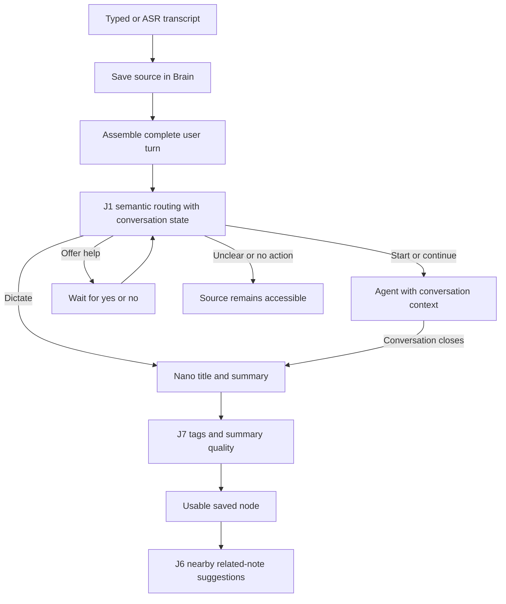

# Agent phase architecture

The Agent saves source text before deciding what to do with it. A Brain implementation provides storage and retrieval through `BrainPort`; it does not own conversation policy, speech, or model calls. Speech uses local **Whisper large-v3-turbo + Silero speech detection + the `Moo.` hint**, with full large-v3 as an explicit configuration option. [Speech implementation and configuration](whisper-integration.md).

## Modules and ownership

| Module | Responsibility |
| --- | --- |
| `packages/contracts` | Host-neutral records, revisions, provider/Brain interfaces and portable Markdown codec. |
| `packages/agent` | Conversation state, routing, tool execution, help offers, enrichment, retries and local-versus-accepted status. It imports no Electron, database, Obsidian or provider SDK. |
| `packages/brain` | SQLite/file persistence and a separate in-memory adapter. Neither is required by the Agent class; the host injects a `BrainPort`. |
| `apps/runtime` | Independently runnable Node host, authenticated loopback HTTP/SSE API, backend transport and native process bridge. It wires implementations together. |
| `apps/desktop` | Electron/React controls, transcripts, saved notes, edits and status. It communicates with the runtime rather than owning the Agent. |
| `native` | Swift microphone capture, the local ASR protocol, Apple speech synthesis and explicitly requested screen capture. |
| `scripts` speech adapter | Pinned resident whisper.cpp runtime and a bounded local PCM/utterance bridge; model choice comes from `asr-config.json`. |
| `backend` | One FastAPI service for Jev, Nebius and Tavily calls plus accepted Postgres snapshots. Provider credentials stay in this process. |

There is no plugin registry or service per Jev gate. Replacing the Brain means supplying another `BrainPort` and changing host wiring. The standalone runtime and native companion remain usable without the custom desktop UI.

## One retained source, three Jev jobs

**J1** chooses among state-appropriate `start_agent`, `continue_agent`, `offer_help`, `end_agent`, `dictate`, `no_action` and `unclear`. Pending help, clarification and work are context for this same gate. General help waits for acceptance without screen capture; the screen-assisted saved-doubt offer remains distinct. Clarification links the original request and intermediate constraints.

An active exchange receives every speech block continuously. J1 runs after a complete turn is assembled, not on every chunk; `continue_agent` preserves the exchange. Stable segment IDs and revisions protect corrections. Durable turn ownership sends late corrections back to their original note or conversation. Queued turns retain all their blocks before response generation. J1 receives the assembled turn, recent session context and linked clarification/help request. A speech block does not close a conversation.

Natural endings, **“Moo, finish conversation”** and the End control initiate closing. A provisional 0.8 threshold guards start, stop and help acceptance. Selected dictation while idle and continuation while active preserve that flow without clarification solely because confidence is low; explicit unclear still asks for clarification. Pending work requires finish, cancel or continue. A finish choice can be retracted while work remains. New speech invalidates delayed closure. Controls remain in the source transcript without requiring individual knowledge nodes.

The main agent can return a separate `controlProposal`, never an executable task tool. J1 verifies it against the actual latest user turn and revision; the assistant’s proposed reason is excluded from evidence. A durable operation permits at most one fallback verification per revision. Task completion alone cannot close. The controller applies verified closure after its response scope ends, avoiding a false pending-work offer caused by its own busy flag. These hybrid races are covered by fixture regression tests; the live model did not exercise every fallback case.

An opt-in comparison policy can record a pending closing question with its conversation, source turn and revision. A reply then uses closing-specific criteria within the same J1 call. Stale questions and decisions cannot close; a subsequent clarification replaces the pending question. This policy has no desktop setting and is not enabled by production hosts. Conversation closure remains separate from stopping microphone capture.

**J7** assesses the generated node together with its source. Its purpose vocabulary is Question, Reference, Idea and Action. Nano proposes up to three editable topic suggestions; J7 independently detects unresolved doubt, and can add Off-topic relative to the subject recorded for that note. A subject change during a provider request cannot change the meaning of the assessment halfway through.

Summary quality is Pending, Ready or Needs review. Fidelity and understandable context determine quality; a thought's relevance or value does not. Off-topic and Ready can coexist. The default decision threshold is a configurable, provisional `0.8`, not an evaluated accuracy guarantee. Missing/nonfinite quality assessments cannot produce Ready.

**J6** scores at most five nearby candidates retrieved from the node's source text, summary, title and topics. It adds suggested relationships alongside source/reply provenance. It does not scan the whole graph, merge nodes or delete anything. Failed linking leaves a Ready summary usable and records retryable work. Retry reuses a summary that already matches the source revision.

## Persistence and failure handling

- Each input first updates the durable session transcript; active conversations are also updated continuously. SQLite uses transactions and full synchronization. Returned records are detached from adapter state.
- Source revisions change only when a newer segment revision arrives. Record revisions support compare-and-set enrichment and manual edits. Stale provider results are superseded, and protected manual fields survive later generated patches.
- Server acceptance is separate from local saving. Acknowledgments update synchronization metadata without creating another content revision. Each acceptance operation retains its original serialized payload; retry never reuses an operation ID with newer content.
- Operations and dialogue state survive SQLite restart. Retry processes failed/interrupted work. A superseded source schedules current enrichment. Per-record enrichment is serialized rather than allowing competing background writes.
- Attachments have immutable, path-safe IDs and local files. Accepted backend records currently contain attachment references; media upload and two-way synchronization are later work.
- Markdown export includes readable source/summary and namespaced record metadata. The neutral codec preserves unfamiliar frontmatter and prose outside its generated section. Export is not a watched vault adapter or an Obsidian integration.

The agent tools are note search/read/create, selected-folder search/read, requested screen capture and web search/extraction. “Use only my notes” both removes web tools from the offered list and blocks their execution. Extraction accepts only URLs returned by search in the current response task. Tasks are bounded to six model/tool rounds. Sources beyond the initial enrichment size limit remain intact with a visible processing error rather than being silently truncated.

An optional injected `previewTool` supports validation. Argument and permission checks run first; allowed and blocked proposals are recorded. Results are labelled fixtures with `executed:false`; note creation never returns a saved ID. This also covers accepted saved-doubt capture. Ordinary operation does not install the hook. Source saving, enrichment and isolated backend acceptance still execute in the harness.

## Retrieval and finalization

`BrainPort.search(query, limit, {excludeIds?, kinds?})` applies scope before ranking and limiting. The shared lexical rank uses meaningful whole words, title/topic weights and inverse document frequency. It is intentionally a small local implementation, replaceable in the Brain phase.

`LocalFilesPort` is injected separately from BrainPort. Its ripgrep/filesystem adapter lives in `packages/local-files`; no OS/process imports enter the Agent. Trusted Electron folder selection persists explicit grants through the authenticated loopback runtime; arbitrary renderer paths cannot grant access. Local evidence is refreshed and fingerprint/grant checked before answer publication.

The native response loop retains up to five current Brain excerpts and five local file references plus recent typed tool outcomes. Retrieval errors are distinct from no matches; note revisions, complete user transcript revisions and linked requests are checked before publishing. Historical tool outcomes remain durable; source bodies are replaced by current evidence in model context. The sixth call is answer-only, and there is one grounded invalid-query repair.

Finalization uses existing pending operations and a SHA-256 identity of complete summary context, with source/manual edit checks and explicit retry of failed/interrupted provider work. Close, cancel, capture/session stop and restart checkpoint the same conversation. Nano sees linked original requests and observed tool outcomes, including unresolved/cancelled work. J7 assesses fixed purposes and fidelity/context; Nano supplies editable topics; J6 proposes links for Ready nodes. No extra gate or service was introduced.

The actual Obsidian adapter, Brain editor/search index and two-way synchronization remain future work. Selected-folder Markdown reads do not satisfy the actual Obsidian integration contract.

## Contextual image help

J1 can propose a screen-help offer while retaining the original question and source revision. Acceptance resumes that request with any added constraints; decline, unrelated replies and stale/corrected offers do not authorize capture. The controller takes one fresh screenshot for an accepted request and sends the image and question to MiniCPM. Ultra receives structured vision evidence rather than image bytes.

OCR fields distinguish readable, unreadable and absent values with source excerpts and visible labels. Visual mode provides located features and tentative hypotheses referencing those features. Contradictory or unsupported evidence is withheld while raw output remains retained. These checks cannot independently establish pixel truth; an uncertain model result remains unresolved. The actual Obsidian adapter and full Brain interface remain later-phase work.

Tests exercise the same controller against MemoryBrain and SQLiteBrain and separately verify restart durability. This establishes replaceable storage boundaries, not an implemented Obsidian adapter. Automated fixtures do not prove provider accuracy or microphone performance.
